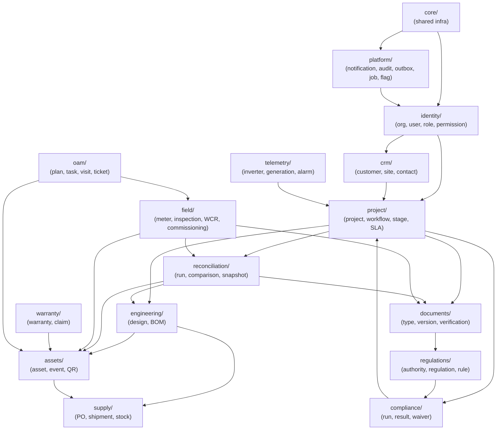

# Solar Operations OS — Module Map

> Last updated: 2026-10-01  
> Architecture style: Modular Monolith with strict import boundaries enforced by `importlinter`

---

## Guiding Rule

Every domain module (`app/modules/<name>/`) owns:
- Its **database tables** (Alembic migrations under its namespace)
- Its **SQLAlchemy models** (never imported directly by another module)
- Its **Pydantic schemas** (public DTOs exported via `<module>.public`)
- Its **service interface** (`<module>.service`) — the ONLY entry point for other modules
- Its **domain events** (`<module>.events`) — the ONLY async coupling to other modules

Cross-module access via anything other than `service` or `events` is a **CI failure**.

---

## Module Dependency Graph

---

## Module Details

### `core/` — Shared Infrastructure (no domain logic)

**Provides:**
- `core.db` — async session factory, tenant context var, RLS activation helper
- `core.security` — JWT sign/verify, argon2id, TOTP
- `core.auth` — dependency injection: `get_current_user`, `require_permission`
- `core.policy` — RBAC + ABAC central policy evaluator
- `core.errors` — RFC 7807 problem details model and exception handlers
- `core.pagination` — cursor-based pagination helpers
- `core.idempotency` — idempotency key store and decorator
- `core.events` — domain event bus (in-process fan-out + transactional outbox bridge)
- `core.telemetry_otel` — OpenTelemetry setup, structured logging, Prometheus
- `core.storage` — S3-compatible object store client, content-hash helpers
- `core.config` — Pydantic settings with environment variable loading
- `core.plant_id` — Plant ID allocation service (SOL-MP-000124 format)
- `core.feature_flags` — per-org, per-plan flag evaluation

---

### `identity/` — Organization and Identity

**Tables:** organization, branch, team, user, role, permission, role_permission, membership, session, device, api_key

**Domain events emitted:**
- UserCreated, UserDeactivated, RoleChanged, MemberInvited, MemberRemoved

---

### `crm/` — Customers and Sites

**Tables:** customer, contact, site, site_survey, site_photo

**Domain events emitted:** CustomerCreated, SiteCreated, SiteUpdated

---

### `project/` — Projects and Workflow Engine

**Tables:** project, application, approval, workflow_definition, workflow_version, workflow_instance, stage_history, workflow_transition_override

**Domain events emitted:** ProjectCreated, ProjectStageTransitioned, ProjectStuck, ProjectCompleted

---

### `engineering/` — Design and BOM

**Tables:** design, bom, bom_item, string_configuration, expected_generation

**Domain events emitted:** DesignCreated, DesignRevised, BOMFinalised

---

### `assets/` — Asset Registry and Traceability

**Tables:** asset_type, asset, asset_event, asset_relationship, qr_token

**Domain events emitted:** AssetRegistered, AssetAllocated, AssetInstalled, AssetReplaced, AssetRetired

---

### `supply/` — Procurement and Inventory

**Tables:** supplier, purchase_order, po_line, shipment, shipment_line, warehouse, stock_movement, allocation

**Domain events emitted:** POCreated, ShipmentReceived, StockAllocated, StockAdjusted

---

### `documents/` — Document Store and Verification

**Tables:** document_type, document, document_version, document_verification, extracted_field, document_expiry, certificate, required_document_set, required_document

**Domain events emitted:** DocumentUploaded, DocumentVerified, DocumentRejected, DocumentExpired, CertificateIssued

---

### `regulations/` — Regulation Library and Rules DSL

**Tables:** authority, regulation, regulation_version, rule, rule_version, rule_set, rule_set_membership, rule_applicability, rule_test_case

**Domain events emitted:** RulePublished, RegulationSuperseded, RuleReviewDue

---

### `compliance/` — Compliance Engine

**Tables:** compliance_run, compliance_result, compliance_exception, compliance_waiver

**Domain events emitted:** ComplianceRunCompleted, ComplianceFailed, WaiverGranted, WaiverExpired

---

### `reconciliation/` — Planned→Actual→Verified Engine

**Tables:** reconciliation_run, reconciliation_comparison, source_snapshot

**Domain events emitted:** ReconciliationRunCompleted, MismatchDetected, MismatchResolved

---

### `field/` — Metering, Inspection, WCR, Commissioning

**Tables:** meter, meter_test, inspection_template, inspection, inspection_item, wcr, wcr_version, commissioning_record

**Domain events emitted:** InspectionCompleted, WCRGenerated, Commissioned

---

### `warranty/` — Warranty and Claims

**Tables:** warranty, warranty_claim, claim_event

**Domain events emitted:** WarrantyRegistered, ClaimOpened, ClaimResolved, WarrantyExpiring

---

### `oam/` — O&M and Service

**Tables:** maintenance_plan, maintenance_task, visit, visit_item, ticket, ticket_event, sla_policy

**Domain events emitted:** TicketOpened, TicketAssigned, TicketResolved, SLABreached, VisitCompleted, MaintenanceDue

---

### `telemetry/` — Inverter Data and Analytics

**Tables:** inverter_device, data_source_config, generation_record (hypertable), raw_telemetry (hypertable), telemetry_alarm, outage

**Domain events emitted:** GenerationDataIngested, AlarmRaised, OutageDetected, DataQualityFlagged

---

### `platform/` — Cross-Cutting Platform Services

**Tables:** notification, notification_preference, notification_template, audit_event, outbox_event, job, feature_flag, export_job, idempotency_key

Platform is the event consumer — it processes events from all modules but emits none of its own.
